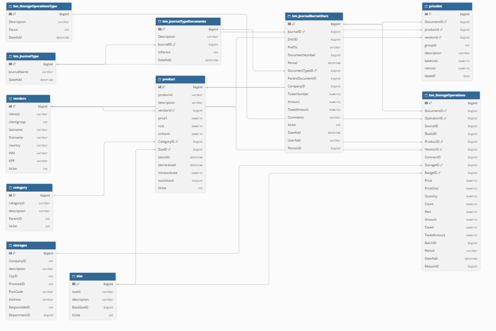
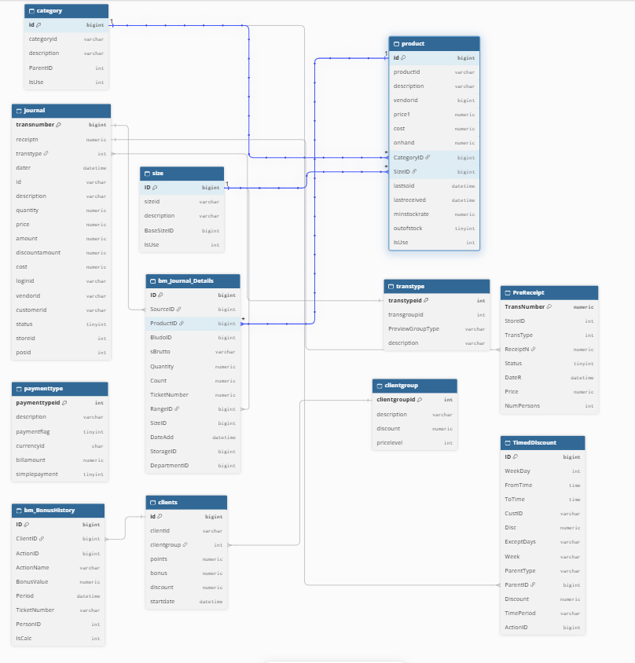
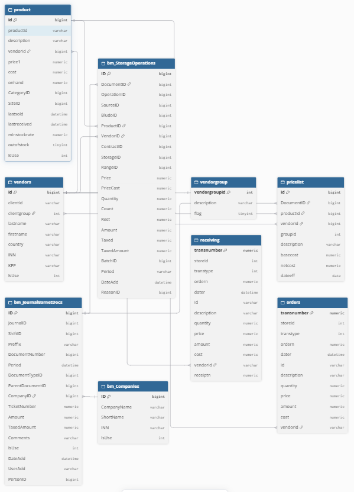
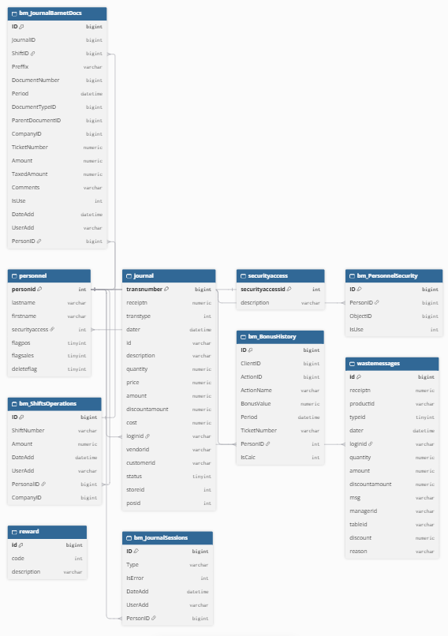
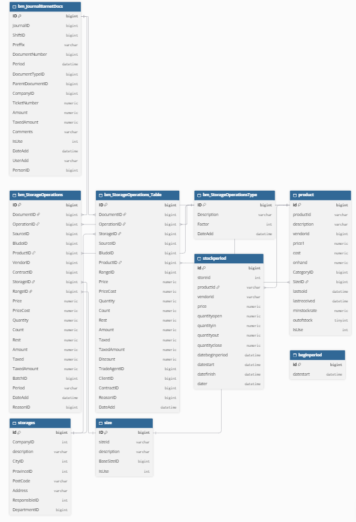

# Анализ наличия ресурсов в базе Front

База Front (MS SQL Server) — исходная система «ООО Ромашка» (кафе/доставка). Ниже по каждому из пяти направлений: основные и связанные таблицы, колонки с назначением и примером данных, ER-диаграмма. Примеры взяты из реальных строк БД; персональные данные заменены условными.

## Общие выводы о состоянии данных

- Живые данные (сотни тысяч строк): `bm_Journal_Details` (1 089 641), `bm_StorageOperations` (1 031 198), `journal` (225 681), `bm_JournalSessions` (174 072), `bm_JournalBarnetDocs` (55 149).
- Таблицы остатков (`stock`, `onhand`, `storagesonhand`, `closingcount`) и договоров/оплат (`bm_Contracts`, `bm_PaymentOperations`, `bm_CashOperations`) **пусты** — остатки нужно считать из движений `bm_StorageOperations`. В данных есть только два типа операций: 1 — поступление (22 016 строк, `Count` ≥ 0) и 2 — списание (1 009 182 строк, `Count` и `Amount` уже **отрицательные**), поэтому остаток = `SUM(Count)` без умножения на `Factor`. Поступления оформлены документами двух видов: «Поступление продуктов» (4) и «Товарный чек» (6). Данные закупок: ноябрь 2020 – декабрь 2023 (декабрь 2023 неполный).
- Справочники `receiving`, `orders`, `wastemessages`, `stockperiod`, `beginperiod` содержат только старые/тестовые данные (2002–2015 гг.), для анализа используются как справка.
- Внешних ключей на поставщика (`VendorID`, `product.vendorid`, `pricelist.vendorid`) и сотрудника (`journal.loginid`) нет — связи **логические**, на диаграммах показаны пунктиром, корректность проверяется SQL-запросами.
- Шаг анализа по направлениям: закупки — месяц; продажи — месяц; поставщики — месяц; персонал — полугодие и квартал; остатки — неделя. ABC-анализ: группа A — товары до 80 % накопленной суммы, B — до 95 %, C — остальные.

## 1. Анализ закупки продукции

**Шаг анализа:** месяц.  
**Основные таблицы:** `bm_StorageOperations`, `bm_JournalBarnetDocs`  
**Связанные таблицы:** `bm_StorageOperationsType`, `bm_JournalTypeDocuments`, `bm_JournalType`, `product`, `category`, `vendors`, `storages`, `size`, `pricelist`

### `bm_StorageOperations` (основная)

Складские операции (строки документов): поступления, списания, инвентаризации, перемещения, возвраты по товарам и складам. Самая большая учётная таблица (≈1 млн строк).

| Колонка | Тип | Назначение | Пример |
|---|---|---|---|
| `ID` | bigint | Идентификатор строки операции | 4780421 |
| `DocumentID` | bigint | Документ-основание (bm_JournalBarnetDocs.ID) | 388235 |
| `OperationID` | bigint | Тип операции (bm_StorageOperationsType): 1 Поступление, 2 Списание, ... | 1 |
| `SourceID` | bigint | Строка-источник операции (для поступлений 0) | 0 |
| `BludoID` | bigint | Блюдо, под которое списан ингредиент (product.id), 0 если нет | 0 |
| `ProductID` | bigint | Товар / ингредиент (product.id) | 4368 |
| `VendorID` | bigint | Поставщик (vendors.id); внешнего ключа в БД нет | 200 |
| `ContractID` | bigint | Договор (bm_Contracts пуста, обычно 0) | 0 |
| `StorageID` | bigint | Склад (storages.id) | 41 |
| `RangeID` | bigint | Единица измерения (size.ID) | 42 |
| `Price` | numeric | Цена за единицу | 323.0 |
| `PriceCost` | numeric | Себестоимость за единицу | 0.0 |
| `Quantity` | numeric | Количество в штучных единицах | 0.0 |
| `Count` | numeric | Количество в базовых единицах (кг, л); по нему считается сумма | 2.764 |
| `Rest` | numeric | Остаток после операции (в выборке 0) | 0.0 |
| `Amount` | numeric | Сумма по строке (≈ Price × Count) | 892.77 |
| `Taxed` | numeric | Ставка налога | 0.0 |
| `TaxedAmount` | numeric | Сумма налога | 0.0 |
| `BatchID` | bigint | Партия | 0 |
| `Period` | varchar | Учётный месяц в формате ГГГГММ | 202011 |
| `DateAdd` | datetime | Дата и время операции | 2020-11-15T14:15:30.183 |
| `ReasonID` | bigint | Причина (для списаний) | NULL |

### `bm_JournalBarnetDocs` (основная)

Журнал документов: «шапки» всех документов учёта (хозяйственных, складских, кассовых) с типом, датой, сменой, суммой и автором. Строки документов лежат в bm_StorageOperations и др.

| Колонка | Тип | Назначение | Пример |
|---|---|---|---|
| `ID` |  | Идентификатор документа (первичный ключ) | 1216 |
| `JournalID` |  | Журнал учёта, к которому относится документ (bm_JournalType) | 1 |
| `ShiftID` |  | Смена, в которую создан документ (bm_ShiftsOperations) | 65 |
| `Preffix` |  | Префикс номера документа | '' (пусто) |
| `DocumentNumber` |  | Номер документа | 1 |
| `Period` |  | Учётный период (дата документа) | 2013-07-23T10:00:00 |
| `DocumentTypeID` |  | Вид документа (bm_JournalTypeDocuments), например «Поступление продуктов» | 1 |
| `ParentDocumentID` |  | Родительский документ (0 — нет родителя) | 0 |
| `CompanyID` |  | Организация (bm_Companies) | 6 |
| `TicketNumber` |  | Номер чека, если документ связан с продажей | NULL |
| `Amount` |  | Сумма документа | 0.0 |
| `TaxedAmount` |  | Сумма налога | 0.0 |
| `Comments` |  | Комментарий | '' (пусто) |
| `IsUse` |  | Признак использования (1 — действует) | 1 |
| `DateAdd` |  | Дата и время создания записи | 2013-07-23T17:45:46.217 |
| `UserAdd` |  | Пользователь, создавший запись | userdb |
| `PersonID` |  | Сотрудник — автор документа (personnel.personid) | 897 |

### `bm_StorageOperationsType` (связанная)

Справочник типов складских операций; Factor задаёт знак: 1 — увеличивает остаток, −1 — уменьшает.

| Колонка | Тип | Назначение | Пример |
|---|---|---|---|
| `ID` | bigint | Идентификатор типа операции | 1 |
| `Description` | varchar | Название: Поступление, Списание, Инвентаризация, Перемещение, Возврат | Поступление |
| `Factor` | int | Множитель остатка: 1 или −1 | 1 |
| `DateAdd` | datetime | Дата создания записи | 2013-01-15T15:19:12.517 |

### `bm_JournalTypeDocuments` (связанная)

Справочник видов документов (например, «Поступление продуктов», «Списание продуктов»).

| Колонка | Тип | Назначение | Пример |
|---|---|---|---|
| `ID` | bigint | Идентификатор вида документа | 1 |
| `Description` | varchar | Название вида документа | Ввод состава нового рецепта |
| `JournalID` | bigint | Журнал учёта (bm_JournalType.ID) | 1 |
| `IsParent` | int | Признак группирующего (родительского) вида | 0 |
| `DateAdd` | datetime | Дата создания записи | 2012-11-28T11:19:43.500 |

### `bm_JournalType` (связанная)

Справочник журналов учёта: хозяйственный, финансовый, складской, кассовый, производство.

| Колонка | Тип | Назначение | Пример |
|---|---|---|---|
| `ID` | bigint | Идентификатор журнала | 1 |
| `JournalName` | varchar | Название журнала | Хозяйственный учет |
| `DateAdd` | datetime | Дата создания записи | 2012-11-28T11:16:02.013 |

### `product` (связанная)

Номенклатура: товары, ингредиенты и блюда (119 колонок, в анализе используются основные). Единая карточка для склада и меню.

| Колонка | Тип | Назначение | Пример |
|---|---|---|---|
| `id` | bigint | Идентификатор карточки (первичный ключ) | 4337 |
| `productid` | varchar | Код номенклатуры (строка) | 1204073 |
| `description` | varchar | Наименование | Бананы |
| `vendorid` | bigint | Основной поставщик (vendors.id); внешнего ключа нет | 107 |
| `price1` | numeric | Розничная цена (тип цены 1) | NULL |
| `cost` | numeric | Себестоимость | 0.0 |
| `onhand` | numeric | Остаток по карточке (поле не поддерживается, NULL) | NULL |
| `CategoryID` | bigint | Категория (category.id) | 200 |
| `SizeID` | bigint | Единица измерения (size.ID) | 42 |
| `lastsold` | datetime | Дата последней продажи | NULL |
| `lastreceived` | datetime | Дата последнего поступления | NULL |
| `minstockrate` | numeric | Минимальный остаток | 0.0 |
| `outofstock` | tinyint | Признак «закончился» (временно снят с продажи) | 0 |
| `IsUse` | int | Признак использования (1 — действует) | 0 |

### `category` (связанная)

Дерево категорий номенклатуры и меню (например, «Меню кафе» → «Пицца» → «24 см»).

| Колонка | Тип | Назначение | Пример |
|---|---|---|---|
| `id` | bigint | Идентификатор категории | 147 |
| `categoryid` | varchar | Код категории (в выборке пусто) | NULL |
| `description` | varchar | Название категории | Меню доставка |
| `ParentID` | int | Родительская категория (0 — корень) | 0 |
| `IsUse` | int | Признак использования | 1 |

### `vendors` (связанная)

Справочник поставщиков (63 записи). Структура общая с клиентами, поэтому много неиспользуемых колонок.

| Колонка | Тип | Назначение | Пример |
|---|---|---|---|
| `id` | bigint | Идентификатор поставщика | 90 |
| `clientid` | varchar | Краткое имя / код поставщика | Иванов |
| `clientgroup` | int | Группа поставщиков (vendorgroup) | 32 |
| `lastname` | varchar | Фамилия / наименование (часто NULL) | NULL |
| `firstname` | varchar | Наименование поставщика | ИП Иванов |
| `country` | varchar | Страна | '' (пусто) |
| `INN` | varchar | ИНН | '' (пусто) |
| `KPP` | varchar | КПП | '' (пусто) |
| `IsUse` | int | Признак использования (1 — действует) | 0 |

### `storages` (связанная)

Склады организации (в базе один склад).

| Колонка | Тип | Назначение | Пример |
|---|---|---|---|
| `id` | bigint | Идентификатор склада | 41 |
| `CompanyID` | int | Организация (bm_Companies.ID) | 6 |
| `description` | varchar | Название склада | Склад |
| `CityID` | int | Город | NULL |
| `ProvinceID` | int | Регион | NULL |
| `PostCode` | varchar | Индекс | NULL |
| `Address` | varchar | Адрес | NULL |
| `ResponsibleID` | int | Ответственный сотрудник (personnel.personid) | 897 |
| `DepartmentID` | bigint | Подразделение | 0 |

### `size` (связанная)

Справочник единиц измерения и размеров порций.

| Колонка | Тип | Назначение | Пример |
|---|---|---|---|
| `ID` | bigint | Идентификатор единицы | 1 |
| `sizeid` | varchar | Код единицы | порция |
| `description` | varchar | Название (порция, 100г, 50мл и др.) | порция |
| `BaseSizeID` | bigint | Базовая единица, к которой приводится | 642 |
| `IsUse` | int | Признак использования | 1 |

### `pricelist` (связанная)

Прайс-лист: закупочные (базовые) цены товаров по группам цен и документам установки цен.

| Колонка | Тип | Назначение | Пример |
|---|---|---|---|
| `id` | bigint | Идентификатор строки прайса | 113681 |
| `DocumentID` | bigint | Документ установки цен (bm_JournalBarnetDocs.ID) | 142417 |
| `productid` | bigint | Товар (product.id) | 4544 |
| `vendorid` | bigint | Поставщик (vendors.id); часто NULL | NULL |
| `groupid` | int | Группа цен (pricegroup) | 2 |
| `description` | varchar | Описание | NULL |
| `basecost` | numeric | Базовая (закупочная) цена | 140.0 |
| `netcost` | numeric | Цена нетто | NULL |
| `dateeff` | date | Дата начала действия цены | NULL |

## 2. Анализ продажи товара

**Шаг анализа:** месяц.  
**Основные таблицы:** `journal`, `bm_Journal_Details`  
**Связанные таблицы:** `transtype`, `product`, `category`, `size`, `PreReceipt`, `paymenttype`, `clients`, `clientgroup`, `TimedDiscount`, `bm_BonusHistory`

### `journal` (основная)

Журнал чеков/операций кассы (≈226 тыс. строк): одна строка — одна позиция чека. Основа анализа продаж; тип операции задаётся transtype.

| Колонка | Тип | Назначение | Пример |
|---|---|---|---|
| `transnumber` | bigint | Номер строки журнала (первичный ключ, ссылка из bm_Journal_Details) | 1675584 |
| `receiptn` | numeric | Номер чека (одинаков у всех позиций чека) | 0 |
| `transtype` | int | Тип операции (transtype): 101 — продажа, 102 — возврат и др. | 301 |
| `dater` | datetime | Дата и время операции | 2020-11-10T09:49:09 |
| `id` | varchar | Код проданной позиции (строка) | 906 |
| `description` | varchar | Название позиции на момент продажи | Доставка |
| `quantity` | numeric | Количество | 0.0 |
| `price` | numeric | Цена | 0.0 |
| `amount` | numeric | Сумма по позиции | 0.0 |
| `discountamount` | numeric | Сумма скидки | 0.0 |
| `cost` | numeric | Себестоимость | 0.0 |
| `loginid` | varchar | Сотрудник, пробивший чек (personnel.personid в виде строки) | 906 |
| `vendorid` | varchar | Поставщик (для закупочных операций) | '' (пусто) |
| `customerid` | varchar | Клиент | '' (пусто) |
| `status` | tinyint | Статус операции | 0 |
| `storeid` | int | Торговая точка | 0 |
| `posid` | int | Номер кассы | 1 |

### `bm_Journal_Details` (основная)

Расшифровка продаж (≈1,09 млн строк): для каждой строки журнала — ингредиенты блюда, списываемые со склада.

| Колонка | Тип | Назначение | Пример |
|---|---|---|---|
| `ID` | bigint | Идентификатор строки | 11530445 |
| `SourceID` | bigint | Строка журнала-источник (journal.transnumber) | 1675591 |
| `ProductID` | bigint | Ингредиент (product.id) | 4407 |
| `BludoID` | bigint | Блюдо (product.id) | 4451 |
| `sBrutto` | varchar | Масса брутто (строка) | 400.000 |
| `Quantity` | numeric | Количество порций | 1.0 |
| `Count` | numeric | Расход ингредиента в базовых единицах | 0.4 |
| `TicketNumber` | numeric | Номер чека (journal.receiptn) | 14740696 |
| `RangeID` | bigint | Единица измерения (size.ID) | 42 |
| `SizeID` | bigint | Размер порции | 163 |
| `DateAdd` | datetime | Дата и время | 2020-11-11T10:09:39.690 |
| `StorageID` | bigint | Склад (storages.id) | 41 |
| `DepartmentID` | bigint | Подразделение | 0 |

### `transtype` (связанная)

Справочник типов операций журнала (продажа, возврат, аренда и др.).

| Колонка | Тип | Назначение | Пример |
|---|---|---|---|
| `transtypeid` | int | Идентификатор типа операции | 14 |
| `transgroupid` | int | Группа типов | 14 |
| `PreviewGroupType` | varchar | Раздел (POS и др.) | POS |
| `description` | varchar | Название типа операции | Rent |

### `product` (связанная)

Номенклатура: товары, ингредиенты и блюда (119 колонок, в анализе используются основные). Единая карточка для склада и меню.

Колонки, назначение и примеры — в описании таблицы в направлении 1 (выше).

### `category` (связанная)

Дерево категорий номенклатуры и меню (например, «Меню кафе» → «Пицца» → «24 см»).

Колонки, назначение и примеры — в описании таблицы в направлении 1 (выше).

### `size` (связанная)

Справочник единиц измерения и размеров порций.

Колонки, назначение и примеры — в описании таблицы в направлении 1 (выше).

### `PreReceipt` (связанная)

Предварительные чеки (счета гостю): заказы, ещё не закрытые оплатой.

| Колонка | Тип | Назначение | Пример |
|---|---|---|---|
| `TransNumber` | numeric | Номер записи | 1 |
| `StoreID` | int | Торговая точка | 1 |
| `TransType` | int | Тип операции | 706 |
| `ReceiptN` | numeric | Номер чека | 130200619 |
| `Status` | tinyint | Статус (1 — закрыт) | 1 |
| `DateR` | datetime | Дата и время | 2013-02-26T09:21:05.473 |
| `Price` | numeric | Сумма | 200.0 |
| `NumPersons` | int | Число гостей | NULL |

### `paymenttype` (связанная)

Справочник способов оплаты (наличные, карта, безнал). Таблица операций оплат bm_PaymentOperations пуста.

| Колонка | Тип | Назначение | Пример |
|---|---|---|---|
| `paymenttypeid` | int | Идентификатор способа оплаты | 211 |
| `description` | varchar | Название | Наличные |
| `paymentflag` | tinyint | Признак вида оплаты | 1 |
| `currencyid` | char | Валюта | NULL |
| `billamount` | numeric | Номинал | 0.0 |
| `simplepayment` | tinyint | Признак простой оплаты | 1 |

### `clients` (связанная)

Справочник клиентов с бонусами и скидками (66 колонок; персональные данные в анализе не используются).

| Колонка | Тип | Назначение | Пример |
|---|---|---|---|
| `id` | bigint | Идентификатор клиента | 109 |
| `clientid` | varchar | Номер карты/код клиента | 1234 |
| `clientgroup` | int | Группа клиента (clientgroup) | 37 |
| `points` | numeric | Накопленные баллы | 0.0 |
| `bonus` | numeric | Бонус/процент | 10.0 |
| `discount` | numeric | Персональная скидка | 0.0 |
| `startdate` | datetime | Дата регистрации | 2013-08-03T18:49:29.400 |

### `clientgroup` (связанная)

Справочник групп клиентов со скидками.

| Колонка | Тип | Назначение | Пример |
|---|---|---|---|
| `clientgroupid` | int | Идентификатор группы | 37 |
| `description` | varchar | Название группы | Дсконт карты |
| `discount` | numeric | Скидка группы, % | 5.0 |
| `pricelevel` | int | Уровень цен | 0 |

### `TimedDiscount` (связанная)

Скидки по времени (счастливые часы): % скидки для категории в заданные часы и дни недели.

| Колонка | Тип | Назначение | Пример |
|---|---|---|---|
| `ID` | bigint | Идентификатор | 1 |
| `WeekDay` | int | День недели (устаревшее) | NULL |
| `FromTime` | time | С времени | NULL |
| `ToTime` | time | По время | NULL |
| `CustID` | varchar | Клиент | NULL |
| `Disc` | numeric | Скидка (устаревшее поле) | NULL |
| `ExceptDays` | varchar | Дни-исключения | NULL |
| `Week` | varchar | Маска дней недели «пн..вс» (1 — действует) | 1,1,1,1,1,0,0 |
| `ParentType` | varchar | К чему применяется (Category) | Category |
| `ParentID` | bigint | Идентификатор категории | 157 |
| `Discount` | numeric | Размер скидки, % | 15.0 |
| `TimePeriod` | varchar | Часы действия | 10:00-15:00 |
| `ActionID` | bigint | Акция (promo.id) | 1 |

### `bm_BonusHistory` (связанная)

История начисления бонусов клиентам.

| Колонка | Тип | Назначение | Пример |
|---|---|---|---|
| `ID` | bigint | Идентификатор записи | 1 |
| `ClientID` | bigint | Клиент (clients.id) | 3352 |
| `ActionID` | bigint | Акция | NULL |
| `ActionName` | varchar | Кто/что начислило | User |
| `BonusValue` | numeric | Размер бонуса | 0.0 |
| `Period` | datetime | Дата и время | 2016-04-05T11:31:10.553 |
| `TicketNumber` | varchar | Номер чека | NULL |
| `PersonID` | int | Сотрудник (personnel.personid) | 897 |
| `IsCalc` | int | Признак расчёта | NULL |

## 3. Анализ взаимоотношений с поставщиками

**Шаг анализа:** месяц.  
**Основные таблицы:** `vendors`, `bm_StorageOperations`  
**Связанные таблицы:** `vendorgroup`, `pricelist`, `product`, `bm_JournalBarnetDocs`, `bm_Companies`, `receiving`, `orders`

### `vendors` (основная)

Справочник поставщиков (63 записи). Структура общая с клиентами, поэтому много неиспользуемых колонок.

Колонки, назначение и примеры — в описании таблицы в направлении 1 (выше).

### `bm_StorageOperations` (основная)

Складские операции (строки документов): поступления, списания, инвентаризации, перемещения, возвраты по товарам и складам. Самая большая учётная таблица (≈1 млн строк).

Колонки, назначение и примеры — в описании таблицы в направлении 1 (выше).

### `vendorgroup` (связанная)

Справочник групп поставщиков.

| Колонка | Тип | Назначение | Пример |
|---|---|---|---|
| `vendorgroupid` | int | Идентификатор группы | 31 |
| `description` | varchar | Название группы | Поставщики |
| `flag` | tinyint | Служебный признак | 0 |

### `pricelist` (связанная)

Прайс-лист: закупочные (базовые) цены товаров по группам цен и документам установки цен.

Колонки, назначение и примеры — в описании таблицы в направлении 1 (выше).

### `product` (связанная)

Номенклатура: товары, ингредиенты и блюда (119 колонок, в анализе используются основные). Единая карточка для склада и меню.

Колонки, назначение и примеры — в описании таблицы в направлении 1 (выше).

### `bm_JournalBarnetDocs` (связанная)

Журнал документов: «шапки» всех документов учёта (хозяйственных, складских, кассовых) с типом, датой, сменой, суммой и автором. Строки документов лежат в bm_StorageOperations и др.

Колонки, назначение и примеры — в описании таблицы в направлении 1 (выше).

### `bm_Companies` (связанная)

Справочник организаций (юридических лиц), от имени которых ведётся учёт.

| Колонка | Тип | Назначение | Пример |
|---|---|---|---|
| `ID` | bigint | Идентификатор организации | 6 |
| `CompanyName` | varchar | Полное наименование | ИП Иванова Анна Ивановна |
| `ShortName` | varchar | Краткое название | Кафе «Пример» |
| `INN` | varchar | ИНН | 380100000000 |
| `IsUse` | int | Признак использования | 1 |

### `receiving` (связанная)

Старые приходные накладные (17 строк, 2002 г.). В анализе только как справка.

| Колонка | Тип | Назначение | Пример |
|---|---|---|---|
| `transnumber` | numeric | Номер строки | 4 |
| `storeid` | int | Торговая точка | 0 |
| `transtype` | int | Тип (601 — позиция, 801 — шапка) | 601 |
| `ordern` | numeric | Номер заказа | 1111 |
| `dater` | datetime | Дата | 2002-10-30T00:00:00 |
| `id` | varchar | Код товара | 16 |
| `description` | varchar | Название | GIFT BASKETS |
| `quantity` | numeric | Количество | 10.0 |
| `price` | numeric | Цена | 5.0 |
| `amount` | numeric | Сумма | 50.0 |
| `cost` | numeric | Себестоимость | 0.0 |
| `vendorid` | varchar | Поставщик (текст) | NULL |
| `receiptn` | numeric | Номер накладной | 111 |

### `orders` (связанная)

Старые заказы поставщикам (6 строк, 2007–2009 гг.). В анализе только как справка.

| Колонка | Тип | Назначение | Пример |
|---|---|---|---|
| `transnumber` | numeric | Номер строки | 2 |
| `storeid` | int | Торговая точка | 0 |
| `transtype` | int | Тип (601 — позиция, 801 — шапка) | 801 |
| `ordern` | numeric | Номер заказа | 1 |
| `dater` | datetime | Дата | 2007-08-09T00:00:00 |
| `id` | varchar | Код товара | NULL |
| `description` | varchar | Название | NULL |
| `quantity` | numeric | Количество | 0.0 |
| `price` | numeric | Цена | 0.0 |
| `amount` | numeric | Сумма | 0.0 |
| `cost` | numeric | Себестоимость | 0.0 |
| `vendorid` | varchar | Поставщик (текст) | NULL |

## 4. Анализ работы персонала

**Шаг анализа:** полугодие, квартал.  
**Основные таблицы:** `personnel`, `journal`, `bm_JournalBarnetDocs`  
**Связанные таблицы:** `securityaccess`, `bm_PersonnelSecurity`, `bm_ShiftsOperations`, `bm_JournalSessions`, `bm_BonusHistory`, `wastemessages`, `reward`

### `personnel` (основная)

Справочник сотрудников (109 записей; 42 колонки, пароли и отпечатки в анализе не используются).

| Колонка | Тип | Назначение | Пример |
|---|---|---|---|
| `personid` | int | Идентификатор сотрудника | 897 |
| `lastname` | varchar | Фамилия | Иванов |
| `firstname` | varchar | Имя | Иван |
| `securityaccess` | int | Уровень доступа (securityaccess) | 9 |
| `flagpos` | tinyint | Работает на кассе | 1 |
| `flagsales` | tinyint | Доступ к продажам | 0 |
| `deleteflag` | tinyint | Признак «удалён/неактивен» | 1 |

### `journal` (основная)

Журнал чеков/операций кассы (≈226 тыс. строк): одна строка — одна позиция чека. Основа анализа продаж; тип операции задаётся transtype.

Колонки, назначение и примеры — в описании таблицы в направлении 2 (выше).

### `bm_JournalBarnetDocs` (основная)

Журнал документов: «шапки» всех документов учёта (хозяйственных, складских, кассовых) с типом, датой, сменой, суммой и автором. Строки документов лежат в bm_StorageOperations и др.

Колонки, назначение и примеры — в описании таблицы в направлении 1 (выше).

### `securityaccess` (связанная)

Справочник уровней доступа сотрудников.

| Колонка | Тип | Назначение | Пример |
|---|---|---|---|
| `securityaccessid` | int | Идентификатор уровня | 3 |
| `description` | varchar | Название (Manager, Clerk, Bartender...) | Manager/Adm |

### `bm_PersonnelSecurity` (связанная)

Права сотрудников на объекты системы (меню, формы).

| Колонка | Тип | Назначение | Пример |
|---|---|---|---|
| `ID` | bigint | Идентификатор записи | 1397 |
| `PersonID` | bigint | Сотрудник (personnel.personid) | 906 |
| `ObjectID` | bigint | Защищаемый объект (bm_SecurityObjects.ID) | 36 |
| `IsUse` | int | Право выдано | 1 |

### `bm_ShiftsOperations` (связанная)

Кассовые смены.

| Колонка | Тип | Назначение | Пример |
|---|---|---|---|
| `ID` | bigint | Идентификатор смены | 65 |
| `ShiftNumber` | varchar | Номер смены | 1 |
| `Amount` | numeric | Сумма смены | 0.0 |
| `DateAdd` | datetime | Дата открытия | 2015-07-14T10:29:13.470 |
| `UserAdd` | varchar | Пользователь, открывший смену | sa |
| `PersonalID` | bigint | Сотрудник (personnel.personid) | 0 |
| `CompanyID` | bigint | Организация | 6 |

### `bm_JournalSessions` (связанная)

Журнал сеансов работы пользователей и системных событий (≈174 тыс. строк).

| Колонка | Тип | Назначение | Пример |
|---|---|---|---|
| `ID` | bigint | Идентификатор записи | 1 |
| `Type` | varchar | Тип события (Система и др.) | Система |
| `IsError` | int | Признак ошибки | 0 |
| `DateAdd` | datetime | Дата и время события | 2019-10-10T10:09:48.707 |
| `UserAdd` | varchar | Пользователь | userdb |
| `PersonID` | bigint | Сотрудник (personnel.personid) | 897 |

### `bm_BonusHistory` (связанная)

История начисления бонусов клиентам.

Колонки, назначение и примеры — в описании таблицы в направлении 2 (выше).

### `wastemessages` (связанная)

Журнал списаний/отказов по чекам с причиной и ответственным менеджером (старые данные 2008 г.).

| Колонка | Тип | Назначение | Пример |
|---|---|---|---|
| `id` | bigint | Идентификатор | 1 |
| `receiptn` | numeric | Номер чека | 80400031 |
| `productid` | varchar | Код позиции | 1009 |
| `typeid` | tinyint | Тип списания | 1 |
| `dater` | datetime | Дата и время | 2008-04-13T14:25:08 |
| `loginid` | varchar | Сотрудник | 1 |
| `quantity` | numeric | Количество | 1.0 |
| `amount` | numeric | Сумма | 120.0 |
| `discountamount` | numeric | Сумма скидки | 0.0 |
| `msg` | varchar | Причина (текст) | ЖЗИ |
| `managerid` | varchar | Менеджер, подтвердивший списание | 1 |
| `tableid` | varchar | Стол | 5 |
| `discount` | numeric | Скидка | 0.0 |
| `reason` | varchar | Причина (расширенная) | NULL |

### `reward` (связанная)

Справочник видов поощрений и скидок.

| Колонка | Тип | Назначение | Пример |
|---|---|---|---|
| `id` | bigint | Идентификатор | 202 |
| `code` | int | Код | 6 |
| `description` | varchar | Название | StaffPrice |

## 5. Анализ остатков

**Шаг анализа:** неделя.  
**Основные таблицы:** `bm_StorageOperations`, `bm_StorageOperations_Table`  
**Связанные таблицы:** `bm_StorageOperationsType`, `product`, `storages`, `size`, `bm_JournalBarnetDocs`, `stockperiod`, `beginperiod`

### `bm_StorageOperations` (основная)

Складские операции (строки документов): поступления, списания, инвентаризации, перемещения, возвраты по товарам и складам. Самая большая учётная таблица (≈1 млн строк).

Колонки, назначение и примеры — в описании таблицы в направлении 1 (выше).

### `bm_StorageOperations_Table` (основная)

Складские операции в «табличном» виде (≈31 тыс. строк): в выборке — списания ингредиентов блюд по документу. Имеет те же связи, что и bm_StorageOperations, плюс скидку и клиента.

| Колонка | Тип | Назначение | Пример |
|---|---|---|---|
| `ID` | bigint | Идентификатор строки | 134198 |
| `DocumentID` | bigint | Документ (bm_JournalBarnetDocs.ID) | 388540 |
| `OperationID` | bigint | Тип операции (bm_StorageOperationsType) | 2 |
| `StorageID` | bigint | Склад (storages.id) | 41 |
| `SourceID` | bigint | Строка-источник | 200634 |
| `BludoID` | bigint | Блюдо (product.id) | 4641 |
| `ProductID` | bigint | Товар / ингредиент (product.id) | 4345 |
| `RangeID` | bigint | Единица измерения (size.ID) | 42 |
| `Price` | numeric | Цена | 0.0 |
| `PriceCost` | numeric | Себестоимость | 0.0 |
| `Quantity` | numeric | Количество (штучное) | 0.0 |
| `Count` | numeric | Количество в базовых единицах | 0.0 |
| `Rest` | numeric | Остаток | 0.0 |
| `Amount` | numeric | Сумма | 0.0 |
| `Taxed` | numeric | Ставка налога | 0.18 |
| `TaxedAmount` | numeric | Сумма налога | 0.0 |
| `Discount` | numeric | Скидка | 0.0 |
| `TradeAgentID` | bigint | Торговый агент | 0 |
| `ClientID` | bigint | Клиент (clients.id) | 0 |
| `ContractID` | bigint | Договор | NULL |
| `ReasonID` | bigint | Причина операции | 24 |
| `DateAdd` | datetime | Дата и время операции | 2020-11-15T18:05:37.700 |

### `bm_StorageOperationsType` (связанная)

Справочник типов складских операций; Factor задаёт знак: 1 — увеличивает остаток, −1 — уменьшает.

Колонки, назначение и примеры — в описании таблицы в направлении 1 (выше).

### `product` (связанная)

Номенклатура: товары, ингредиенты и блюда (119 колонок, в анализе используются основные). Единая карточка для склада и меню.

Колонки, назначение и примеры — в описании таблицы в направлении 1 (выше).

### `storages` (связанная)

Склады организации (в базе один склад).

Колонки, назначение и примеры — в описании таблицы в направлении 1 (выше).

### `size` (связанная)

Справочник единиц измерения и размеров порций.

Колонки, назначение и примеры — в описании таблицы в направлении 1 (выше).

### `bm_JournalBarnetDocs` (связанная)

Журнал документов: «шапки» всех документов учёта (хозяйственных, складских, кассовых) с типом, датой, сменой, суммой и автором. Строки документов лежат в bm_StorageOperations и др.

Колонки, назначение и примеры — в описании таблицы в направлении 1 (выше).

### `stockperiod` (связанная)

Остатки по периодам (старая структура, тестовые данные 2015 г.): открытие, приход, расход, закрытие.

| Колонка | Тип | Назначение | Пример |
|---|---|---|---|
| `id` | bigint | Идентификатор | 1 |
| `storeid` | int | Торговая точка | 1 |
| `productid` | varchar | Код товара (строка) | '' (пусто) |
| `vendorid` | varchar | Поставщик | '' (пусто) |
| `price` | numeric | Цена | 2.3 |
| `quantityopen` | numeric | Остаток на начало | 0.0 |
| `quantityin` | numeric | Приход | 10000.0 |
| `quantityout` | numeric | Расход | 14999.0 |
| `quantityclose` | numeric | Остаток на конец | 0.0 |
| `datebeginperiod` | datetime | Начало периода | 2015-02-17T08:20:36.540 |
| `datestart` | datetime | Дата с | 2015-02-17T08:20:36.540 |
| `datefinish` | datetime | Дата по | 2015-02-17T08:20:36.540 |
| `dater` | datetime | Дата записи | 2015-02-17T08:20:36.540 |

### `beginperiod` (связанная)

Даты начала учётных периодов (старая структура).

| Колонка | Тип | Назначение | Пример |
|---|---|---|---|
| `id` | bigint | Идентификатор | 17 |
| `datestart` | datetime | Дата начала периода | 2009-03-17T11:00:00 |
